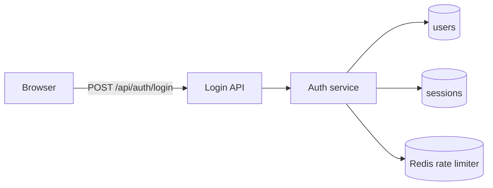
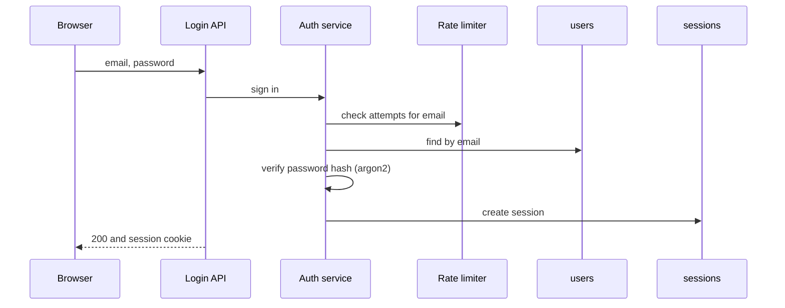

# AUTH.LOGIN: Login

<!--
SpecX spec format. One spec.md per folder holds everything about that part of
the system. Delete these comments when writing a real spec.

The bar: a frontier model writes this spec; a small model then builds every
task from this spec and its context chain alone, without assuming or guessing
anything. This is a specification, not code: it states what the system does
and the technical plan for how (architecture, technology, contracts, data,
flows, rules, failures), but not files, functions, or code. The implementer
chooses the code structure, following the project's conventions. If an
implementer would have to guess a behavior, a library, a field, a status code,
an error message, or a rule, the spec is not done.

IDs: requirements <SPEC>-R#, acceptance criteria <SPEC>-AC#, decisions <SPEC>-D#,
tasks <SPEC>-T#. Keep IDs stable; never reuse a deleted ID.
Every section and subsection stays. Where one does not apply, write
"None: <reason>". Where a parent already covers it, write
"Inherited: <parent ID> §<section>" instead of repeating it.
Every technology, library, pattern, and convention named here must trace to an
answered decision (yours or a parent's) or to current code (path:line).
-->

## 1. Overview

**Purpose:** what this part of the system is for and who uses it, in two or three sentences.

**In scope:**

- …

**Out of scope:** (and which spec owns it instead)

- …

## 2. Context chain

Inherits everything in [specx/spec.md](../../spec.md) → [auth/spec.md](../spec.md).

**Overrides:** None. <!-- or: what this spec changes from a parent, and the decision that allows it -->

## 3. Current state

<!--
What exists today, observed at a named commit. Every claim cites path:line and
the symbol. Cover entry points, modules, data, interfaces, config, tests, and
known gaps or shortcuts in the code. "None: new work" if nothing exists.
-->

Observed at `<commit>`.

- …

## 4. Requirements

<!--
Written in EARS. Every requirement is one testable SHALL statement:
  Ubiquitous:  THE SYSTEM SHALL <response>.
  Event:       WHEN <trigger>, THE SYSTEM SHALL <response>.
  State:       WHILE <state>, THE SYSTEM SHALL <response>.
  Unwanted:    IF <condition>, THEN THE SYSTEM SHALL <response>.
  Optional:    WHERE <feature is included>, THE SYSTEM SHALL <response>.
Include functional, security, performance, resilience, accessibility, and UI
requirements. Use numbers, not adjectives ("within 300 ms at p95", not "fast").
Source: the user (with date or decision ID) or the code (path:line).
-->

| ID | Type | Requirement | Source |
|---|---|---|---|
| AUTH.LOGIN-R1 | Functional | WHEN a user submits a valid email and password, THE SYSTEM SHALL create a session and redirect to `/dashboard`. | user, YYYY-MM-DD |
| AUTH.LOGIN-R2 | Security | IF five sign-in attempts for one account fail within 15 minutes, THEN THE SYSTEM SHALL reject further attempts for 15 minutes with HTTP 429. | AUTH.LOGIN-D2 |
| AUTH.LOGIN-R3 | Performance | THE SYSTEM SHALL answer `POST /api/auth/login` within 300 ms at p95 under 50 requests per second. | user, YYYY-MM-DD |

## 5. Acceptance criteria

<!-- Given/When/Then with concrete values. Each criterion names the requirements it proves and how it is tested (unit, integration, e2e, manual). Every requirement has at least one. -->

**AUTH.LOGIN-AC1** (R1) · integration

- Given user `ada@example.com` with password `correct-horse` and a verified email
- When `POST /api/auth/login` is called with those credentials
- Then the response is `200`, a `session` cookie is set (`HttpOnly; Secure; SameSite=Lax`), and a row exists in `sessions` for that user

## 6. Design

<!--
The technical plan: what to build, how, and with what, at specification level.
Be exact about behavior, contracts, data, and rules; leave files, functions,
and code to the implementer. Diagrams use Mermaid.
-->

### 6.1 Architecture

<!-- Components involved, what each is responsible for, and how they connect. Where this sits in the system. A Mermaid diagram. -->

| Component | Responsibility | Talks to |
|---|---|---|
| Login API | Validates input, calls the auth service, sets the session cookie | Auth service |
| Auth service | Applies the lockout rule, verifies the password, creates the session | users, sessions, rate limiter |

### 6.2 Technology

<!-- Every library, service, and tool this spec uses, with exact version and the decision that chose it. Nothing here may be unapproved. -->

| Need | Choice | Version | Decision |
|---|---|---|---|
| Password hashing | `argon2` | 0.41.x | AUTH.LOGIN-D1 |

### 6.3 Interfaces

<!--
Every contract that crosses a component boundary: routes, APIs, events, jobs,
UI entry points. For each: what it does, every input with its type and rules,
the output, side effects, and every error with status, code, and message.
Describe contracts in tables and prose, not code.
-->

**`POST /api/auth/login`**: signs a user in with email and password.

| Input | Type | Rules |
|---|---|---|
| `email` | string | required; valid email address; at most 254 characters; compared case-insensitively |
| `password` | string | required; 8 to 128 characters |

On success: returns the user's ID and the redirect target `/dashboard`, and sets a `session` cookie (`HttpOnly`, `Secure`, `SameSite=Lax`, expires with the session).

| Status | Code | When | Message shown |
|---|---|---|---|
| 400 | `invalid_input` | Validation fails | "Enter a valid email and password." |
| 401 | `bad_credentials` | Unknown email or wrong password (same response for both) | "Email or password is incorrect." |
| 429 | `rate_limited` | R2 triggered | "Too many attempts. Try again in 15 minutes." |

### 6.4 Data model

<!-- Every entity: fields, types, nullability, defaults, constraints, indexes, relations, ownership, retention. Schema changes with their order and rollback. -->

`sessions`: one row per signed-in browser; owned by the auth service.

| Field | Type | Null | Default | Notes |
|---|---|---|---|---|
| `id` | uuid | no | generated | primary key |
| `user_id` | uuid | no | — | references `users.id`, deleted with the user; indexed |
| `expires_at` | timestamp with time zone | no | now + 30 days | |

Schema change: create `sessions`. Rollback: drop it.

### 6.5 Flows

<!-- Main, alternate, and failure flows as Mermaid sequence diagrams between components, or numbered steps. -->

### 6.6 State and lifecycle

<!-- State machines (Mermaid stateDiagram) for anything with states: allowed transitions, what triggers them, timeouts. -->

### 6.7 Error handling and resilience

<!-- Every failure: cause, detection, what the user sees, what is logged, retry and backoff, idempotency, timeouts. -->

| Failure | Detection | User sees | Logged | Recovery |
|---|---|---|---|---|
| Rate limiter unavailable | connection error on check | normal sign-in (fails open) | `warn auth.ratelimit.unavailable` | retried on the next request |

### 6.8 Security and privacy

<!-- Authentication, authorization (who may do what: a permission table), input validation, secrets handling, data exposure, threats and mitigations. -->

### 6.9 Configuration

<!-- Every setting, environment variable, and feature flag: name, type, default, effect. -->

| Name | Type | Default | Effect |
|---|---|---|---|
| `SESSION_TTL_DAYS` | integer | `30` | How long a session lasts |

### 6.10 Observability

<!-- Log events (name, level, fields; never secrets), metrics (name, type, labels), traces, alerts. -->

### 6.11 Performance and limits

<!-- Targets, quotas, sizes, pagination, caching, concurrency. -->

### 6.12 Testing strategy

<!--
Record the user's approved behavior-change test method (test-first/TDD, tests
alongside implementation, or another method). If unanswered, leave it as an
open decision; Execute must not choose. Describe test levels, fixtures, mocks,
commands, and how each acceptance criterion is verified. Existing CI and test
configuration is current-state evidence, not a new approved gate unless the
user confirms it as target policy.
-->

| Level | What | Proves |
|---|---|---|
| Unit | Lockout counting, password verification | AUTH.LOGIN-AC1, R2 |

**Behavior-change test method:** Open decision until the user approves one. Do not infer a default.

**Approved quality gates:** Record only gates the user approved. Include the criterion or threshold, exact check command, when it runs, failure policy, and decision/source.

| Dimension | Approved criterion or threshold | Exact check or command | Run point | Failure policy | Decision/source |
|---|---|---|---|---|---|
| None yet | None: ask the user before establishing a binding gate | — | — | — | — |

### 6.13 Migration and rollout

<!-- Order of deployment, data migration and backfill, feature flags, backwards compatibility, rollback steps. -->

## 7. Shared with children

<!--
Like a Next.js layout: everything here applies to every child spec below this
folder. Shared contracts, components, error formats, session handling, and
constraints, at the same level of detail as section 6. Children reference it
(for example "Inherited: AUTH.LOGIN §7.1") instead of repeating it.
-->

None: no children yet.

## 8. Children

<!-- One row per child folder. Relation says how children correlate: what they share, and which depend on which. -->

| Spec | Responsibility | Depends on | Build order | Shared context and relation | Status |
|---|---|---|---|---|---|
| [AUTH.LOGIN.SSO](sso/spec.md) | Sign-in through an identity provider | AUTH.LOGIN-T1 | 2 | Uses the shared session (§7); independent of PASSKEYS | draft |

## 9. Decisions

<!-- Every choice for this spec and its children. Status: open | answered | superseded. -->

### AUTH.LOGIN-D1: Password hashing library

- **Status:** open
- **Question:** Which library hashes passwords?
- **Options:**
  1. `argon2` 0.41: memory-hard, current OWASP recommendation; native build step.
  2. `bcryptjs` 2.4: pure JS, no build step; weaker against GPU attacks.
- **Recommendation:** `argon2`, because it is the OWASP first choice. The user decides.
- **Answer:** <!-- the user's words, with the date -->
- **Affects:** §6.2, AUTH.LOGIN-T1

## 10. Tasks

<!--
Status: draft | todo | in-progress | blocked | in-review | done | cancelled.
Parent: the task in the parent spec this task rolls up to. A parent task is done
only when all its child tasks and its own steps are done.
Depends on: tasks that must be merged first. Tasks without a dependency between
them must not share files.
Steps say what to build and which design subsections it implements, clearly
enough that nothing has to be guessed. They do not prescribe code. Files is the
planner's estimate of where the work lands, from the existing codebase, so
parallel tasks do not collide. Verification lists the tests to write and the
commands to run.
-->

### AUTH.LOGIN-T1: AuthService.login with lockout

- **Status:** draft
- **Parent:** AUTH-T1
- **Depends on:** None
- **Covers:** AUTH.LOGIN-R1, AUTH.LOGIN-R2, AUTH.LOGIN-AC1
- **Decisions:** AUTH.LOGIN-D1
- **Files:** `src/server/auth/` <!-- the planner's estimate, from the existing codebase -->
- **Model:** small, because the contract, rules, and errors are fully specified in §6.3–6.7
- **Branch / worktree / PR:** —

**Steps**

1. Implement sign-in in the auth service following the flow in §6.5, using `argon2` (§6.2) to verify the password.
2. Return the errors exactly as in the §6.3 table, with the same response for an unknown email and a wrong password, and apply the lockout rule in R2.
3. Write unit tests for AC1, a wrong password, an unknown email, and the sixth attempt within 15 minutes (§6.12).

**Verification**

- `npm test -- auth`: all tests pass
- `npm run typecheck`: no errors

**Log**

- YYYY-MM-DD: created

## 11. Open questions

None.

## 12. Change log

| Version | Date | Change | Approved by |
|---|---|---|---|
| 1 | YYYY-MM-DD | Created | — |
